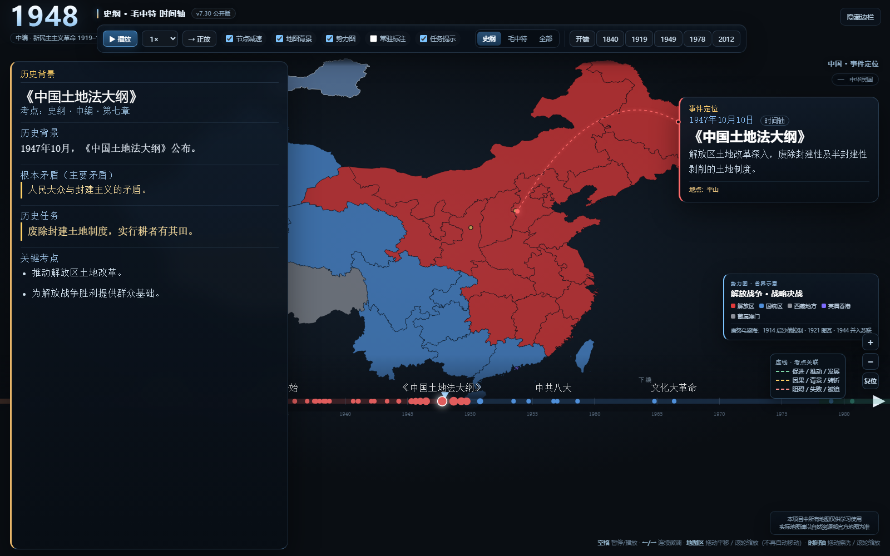

# 史纲 · 毛中特 流光时间轴（v7.30）

2027 考研政治复习工具：**中国近现代史纲要 + 毛中特** 时间轴、历史地图、势力图与考点资料。

> 这是一个离线单文件夹 HTML 工具，不是官方产品，不是教材替代品。  
> 考点内容为 AI 辅助二次整理，使用前请以 2027 考研政治大纲和最新版教材为准。

## 在线使用

**手机/电脑直接打开，不需要下载安装：**

https://akanewton.github.io/shigang-maozhong-timeline/

- 手机横屏体验更好；
- 手机左下角“考点”打开历史任务抽屉；
- 电脑端直接打开同一地址即可。

## 下载离线版

https://github.com/akanewton/shigang-maozhong-timeline/releases/latest

下载后解压，用浏览器打开 `index.html`。  
GitHub 打不开时，可以使用国内网盘备份：

- 百度网盘：https://pan.baidu.com/s/1jX-PuXjXuu8wF3F4hc8QfQ?pwd=0721 提取码：0721

## 功能

- 1840—2022 时间轴：按具体日期定位，同年事件不堆叠；
- 史纲 / 毛中特 / 全部三条轨道；
- 1912 年前使用 CHGIS 1911 历史省界，1912 年后使用现代省界；
- 势力图：按年份切换势力阶段，直接给省块上色，不使用蒙板；
- 关键地点、路线、占领信息：**悬停圆点或路线查看名称**，不常驻文字遮挡地图；
- 事件定位：右侧事件卡 + 按阵营着色虚线（中共红、国民党蓝、外敌灰、中性金）+ 单点/多地点端点，地址只在悬停时显示；
- 左侧历史任务栏：历史背景、根本矛盾、历史任务、关键考点；
- 长征、北伐、秋收、三大战役、渡江路线；
- 三大战役支持锦州/徐州/北平三地点同时连线；
- 毛泽东人生轨迹：韶山—长沙—上海—井冈山—遵义—延安—西柏坡—北京；
- 时间轴末端支持 2022 年末事件居中，史纲/毛中特轨道功能一致；
- 右下角只提供自然资源部标准地图服务链接，不嵌入或再分发官方地图图片。

## 快速开始

1. 下载/克隆本仓库；
2. 直接双击 `index.html`，用 Edge 或 Chrome 打开；
3. 无需安装依赖，无需启动服务器；
4. 建议窗口 1600×1000 以上。

如果使用 GitHub Pages：

- 仓库 Settings → Pages → Source 选择 `Deploy from a branch`；
- 分支选 `main`，目录选 `/ (root)`；
- 发布后直接访问 Pages 地址即可。

## 操作

- 时间轴缩放**完全手动**：手动缩放后比例固定，不随年份自动变化；最大约 12×。
- 手机端点按地图上的地点/路线/势力区域，可显示对应信息；点按后保持，下一次点按更新。

| 操作 | 功能 |
|---|---|
| `空格` | 播放 / 暂停 |
| `←` / `→` | 连续微调；按住加速 |
| `Shift + ←/→` | 一次 5 年 |
| 拖动时间轴 | 擦洗 |
| 时间轴滚轮 | 缩放时间轴 |
| 地图拖动 | 平移地图 |
| 地图滚轮 / 右下角 +− | 缩放地图 |
| `Tab` 或顶部轨道按钮 | 史纲 / 毛中特 / 全部 |
| 勾选“势力图” | 开关势力填色层 |

## 手机使用

- 手机不需要下载安装包，直接用浏览器打开 GitHub Pages 即可；
- 窄屏点左下角“考点”按钮，打开/收起历史任务抽屉；
- 手机上没有鼠标悬停，地点/路线名称的悬停提示目前以桌面端体验最好；
- 需要完整交互时建议用电脑浏览器。

## 数据与目录

| 文件 | 作用 |
|---|---|
| `index.html` | 主程序：时间轴、地图、交互、事件卡 |
| `layers.js` | 势力阶段、军阀图层、路线、关键地点 |
| `kaodian.js` | 事件→章节映射、速览、历史任务、词条、关系线 |
| `mapdata.js` | 现代中国省界 + 世界国界 |
| `qing_phases.js` | 清代阶段疆域、太平天国控制区 |
| `qing_provinces.js` | 1911 年历史省界 |
| `https://bzdt.ch.mnr.gov.cn/` | 自然资源部标准地图服务（页面右下角链接） |
| `考点整理/` | 史纲、毛中特考点总表 |
| `THIRD_PARTY_LICENSES.md` | 第三方数据来源与许可 |

## 数据完整度

- 事件速览：144 / 144
- 专属历史任务：144 / 144
- 具体日期：141 / 144（3 个过程性事件保留年份）
- 事件→章节映射：144 / 144

## 已知限制

- 每个事件都有事件速览和历史任务；主任务已按事件/考点逐条改写；
- 有 3 个过程性事件仍只有年份：英国工业革命、左宗棠收复新疆、一五计划与三大改造；
- 势力范围按主导控制省归并，边界为教学示意，不是精确历史地图；
- 路线为示意折线，不是 GPS 行军轨迹；
- 清代省界用 1911 年省界套 1840—1911，不是逐年精确；
- 地图地点为近似位置，事件地址只到城市/地名级；
- 主交互地图无法直接使用官方标准地图：官方图是静态栅格图，不能直接做省块着色、悬停和动态缩放；本项目使用 DataV/CHGIS 矢量底图做教学示意，官方标准地图仅提供链接。
- 唐努乌梁海 1912—1949 单独显示：1912—1914 中华民国名义，1914—1921 沙俄控制，1921—1944 图瓦，1944 后苏联；悬停/图例注明，不并入侵占色。
- 台湾 1895—1945 显示日占，1945 光复；台湾省按一个中国原则标示；1949 年后填色不代表实际控制。东北 1931—1945 标日占；香港/澳门占领信息按回归年份处理；
- 所有考点为二次整理，不保证与 2027 最新大纲逐字一致。

## 地图与合规

- 主交互地图的现代省界来自 **DataV.GeoAtlas**，历史省界来自 **CHGIS 1911**，世界背景来自 **Natural Earth**；
- 主交互地图**不是**自然资源部标准地图；
- 本项目不再嵌入或再分发官方标准地图图片；
- 页面右下角只提供自然资源部标准地图服务链接；
- 页面声明：**本项目中所有地图仅供学习使用，实际地图请以自然资源部官方地图为准。**

## 免责声明

- 本项目由**非专业开发者借助 DSH（深度求索）**完成；作者不熟悉代码，也不是政治、历史专业的深入研究者。
- 项目代码、事件资料、考点内容由 **DSH（深度求索）从公共领域资料和公开知识中搜集、整理、生成**。
- 受能力和资料限制，代码、日期、史实、考点表述都可能存在错误，请以 2027 考研政治大纲、最新版教材和官方地图为准。
- 如果发现代码或内容错误，请**提交 Issue**，作者会尽快核实修改；也请多多包涵。
- 本项目为个人考研复习工具，与任何院校、出版社或辅导机构均无隶属关系。
- 地图为历史教学示意，不作为领土、边界、外交或法律依据。
- 使用本项目造成的任何复习偏差或损失，作者不承担责任。

## 许可

- **代码**：MIT License，见 `LICENSE`；
- **考点文字与整理内容**：仅供个人学习使用，转载请注明来源；未经许可不得用于商业出版；
- **第三方地图/数据**：见 `THIRD_PARTY_LICENSES.md`；
- **地图**：主交互地图为教学示意；官方标准地图请通过自然资源部标准地图服务查看。

## 贡献

欢迎提交 Issue / PR 修正：

- 事件日期、地点、会议届次、文件名称；
- 章节归属与考点表述；
- 路线、势力范围、占领年份；
- 地图合规与可访问性问题。

提交前请尽量附上教材/正式历史地图/权威来源依据。
